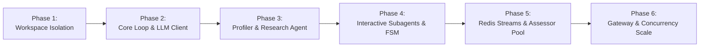

# AI Mock Interview Platform: Core Loop, Session Workspace & Subagent Engine
## Technical Design Specification

- **Date:** 2026-09-24
- **Status:** Draft / Pending Approval
- **Target Scale:** 100+ concurrent active interview sessions
- **Target Location:** `C:\Users\Admin\NNH\Projects\VScode\dpl_pvan`

---

## 1. Executive Summary & Goals

### 1.1 Objective
Build an enterprise-grade, standalone **AI Agent Runtime Engine** for an AI Mock Interview platform. The engine is completely decoupled from the Web/Business Backend service and provides:
1. **Isolated Session Workspace**: A secure, isolated directory per interview session for input data, dynamic context, conversation turns, evaluation artifacts, and final reports.
2. **Loop-first Core Engine**: Streaming-first agent loop (`RuntimeAgent`) supporting thinking tokens, low-latency response tokens (TTFT < 1s), soft schema validation for tool calls, and error self-correction.
3. **Profiler & Research Agent**: A pre-flight agent that ingests candidate background (CV upload OR structured form with target job details), performs external research (company intel, market requirements, tech stack), and dynamically constructs the interview persona, knowledge scope, and stage timeline.
4. **Stage-Delegated Interactive Subagents**: Domain-specialized interviewers (e.g., Tech Lead, HR Manager) that talk directly to the candidate turn-by-turn over WebSocket without per-turn orchestrator bottlenecks.
5. **Background Assessor Worker Pool (Redis-backed)**: An async evaluation pipeline running over Redis Streams. Assessors analyze candidate answers and edge VAD (Voice Activity Detection) metrics concurrently in the background without blocking the interactive dialogue.

### 1.2 Non-Goals (Deferred to Later Milestones)
- Built-in heavy audio processing (Speech-to-Text runs via external API; VAD runs on client edge device; Text-to-Speech runs via external streaming API).
- Long-term cross-session vector memory (focused currently on intra-session context & workspace persistence).
- Full MCP client infrastructure (designed with clean extension interfaces for future MCP server wiring).

---

## 2. System Architecture & Component Boundaries

### 2.1 Decoupled Module Architecture

The system is split into two independent services communicating via standardized REST (Control Plane) and WebSocket (Data Plane):

```
┌──────────────────────────────────────────────────────────────────────────────────┐
│                             Web Client (Browser / App)                           │
│     - Runs local VAD (Silero/WebRTC in WASM) to measure speech/pause metrics     │
│     - Duplex WebSocket connection (Microphone audio / Text / Live Tokens)        │
└─────────────────────────┬────────────────────────────────────────────────────────┘
                          │ (HTTPS / WSS)
┌─────────────────────────▼────────────────────────────────────────────────────────┐
│                        Module 1: Backend Service (Business / App)                │
│     - User Accounts, Authentication & Billing                                    │
│     - Candidate CV upload / Form data intake                                     │
│     - Reverse Proxy / Gateway forwarding to AI Runtime Service                   │
└─────────────────────────┬────────────────────────────────────────────────────────┘
                          │ Internal REST (Session Lifecycle) & WebSocket (Stream)
┌─────────────────────────▼────────────────────────────────────────────────────────┐
│                     Module 2: AI Agent Runtime Service (Standalone)              │
│                                                                                  │
│   ┌───────────────────────────────┐     ┌────────────────────────────────────┐   │
│   │   REST & WebSocket Gateway    │     │   SessionWorkspaceManager          │   │
│   │   - ConnectionManager         │     │   - Folder isolation (SHA-256)     │   │
│   │   - Rate Limit Semaphore      │     │   - Path Traversal Protection      │   │
│   └───────────────┬───────────────┘     └─────────────────┬──────────────────┘   │
│                   │                                       │                      │
│   ┌───────────────▼───────────────┐                       │                      │
│   │   Profiler & Research Agent   │                       │                      │
│   │   - Company & Market Recon    │                       │                      │
│   │   - Customizes StagePlan & Spec ──────────────────────┼─────────────┐        │
│   └───────────────┬───────────────┘                       │             │        │
│                   │                                       │             │        │
│   ┌───────────────▼───────────────┐                       │             │        │
│   │   StageDirector (FSM)         │                       │             │        │
│   │   - Stage transition control  │                       │             │        │
│   └───────────────┬───────────────┘                       │             │        │
│                   │                                       │             │        │
│   ┌───────────────▼───────────────┐                       │             │        │
│   │   Interactive Subagent Runner │                       │             │        │
│   │   - Realtime Token Streaming  │                       │             │        │
│   │   - Context Assembler         │                       │             │        │
│   └───────────────┬───────────────┘                       │             │        │
│                   │ (turn completed)                      │             │        │
└───────────────────┼───────────────────────────────────────┼─────────────┼────────┘
                    │ XADD job                              │             │
┌───────────────────▼───────────────────────────────────────┼─────────────┼────────┐
│                        Shared Infrastructure Layer        │             │        │
│   ┌───────────────────────────────────────────────────┐   │             │        │
│   │   Redis (All-in-One):                             │   │             │        │
│   │   - State Cache: `session:{id}:state`             │   │             │        │
│   │   - Task Queue: Redis Streams (assessment jobs)   │   │             │        │
│   │   - Pub/Sub: `session:{id}:events`                │   │             │        │
│   └───────────────────────┬───────────────────────────┘   │             │        │
│                           │ Dequeue                       │             │        │
│   ┌───────────────────────▼───────────────────────────┐   │             │        │
│   │   Background Assessor Worker Pool                 │   │             │        │
│   │   - Content & Rubric Assessor                     │   │             │        │
│   │   - Delivery & VAD Assessor                       ├───┘             │        │
│   │   - Final Report Synthesizer                      │                 │        │
│   └───────────────────────────────────────────────────┘                 │        │
│                                                                         │        │
│   ┌─────────────────────────────────────────────────────────────────────▼────┐   │
│   │   Local Storage: `/workspaces/{session_id}_{hash}/`                      │   │
│   │   `inputs/` | `context/` | `turns/` | `evaluations/` | `reports/`        │   │
│   └──────────────────────────────────────────────────────────────────────────┘   │
└──────────────────────────────────────────────────────────────────────────────────┘
```

---

## 3. Sequential Phasing & Milestones

To keep implementation strictly modular, testable, and maintainable, development is divided into 6 sequential phases. Each phase builds upon the previous phase without monolithic interdependencies.



---

### Phase 1: Isolated Session Workspace (`core/workspace`)

#### Purpose
Provide a secure, isolated sandbox folder per interview session to store all inputs, generated context, conversation turns, evaluation artifacts, and reports.

#### Key Components
1. **`SessionWorkspace`**:
   - `root_base`: Configurable base path via `WORKSPACE_ROOT_BASE` (default `./data/workspaces`).
   - `normalized_session_id`: Replaces non-alphanumeric chars with `_` and appends `-{sha256(session_id)[:12]}`.
   - `resolve_path(rel_path)`: Resolves path and strictly asserts `resolved.is_relative_to(root.resolve())`. Raises `WorkspacePathError` if path traversal is detected (`../`).
2. **Directory Structure**:
   ```
   /workspaces/{normalized_session_id}/
   ├── inputs/
   │   └── input_source (cv_input.pdf / .txt OR form_input.json)
   ├── context/
   │   ├── company_intel.json
   │   ├── candidate_profile.json
   │   ├── interview_spec.json
   │   └── stage_plan.json
   ├── turns/
   │   ├── turn_001_candidate.json
   │   ├── turn_001_interviewer.json
   │   └── ...
   ├── evaluations/
   │   ├── turn_001_eval.json
   │   └── ...
   ├── reports/
   │   ├── final_assessment.json
   │   └── interview_report.md
   └── spill/
       └── spill_tool_*.json
   ```
3. **Workspace Spillover (`spill.py`)**:
   - When any tool output or context slice exceeds `MAX_TOOL_RESULT_BYTES` (32 KB), saves the full payload to `spill/` and returns `{ "spill_path": "...", "preview": "..." }` to protect LLM context windows.

---

### Phase 2: Core Loop & LLM Client (`core/runtime`)

#### Purpose
Deliver a battle-tested, streaming-first loop engine adapted from `ai-agent-ai`'s `packages/agent-runtime`, optimized for high-throughput streaming and low TTFT.

#### Key Components
1. **`RuntimeLLMClient` Protocol & Implementations**:
   - Generic async protocol:
     ```python
     async def stream_chat(
         self,
         messages: list[dict[str, Any]],
         tools: list[RuntimeTool] | None = None,
         temperature: float = 0.7,
     ) -> AsyncIterator[IterationChunk]: ...
     ```
   - `OpenAIRuntimeLLMClient`: Works with OpenAI, Azure OpenAI, Groq, OpenRouter, and local vLLM OpenAI-compatible endpoints.
2. **`LoopEvent` Types**:
   - `THINKING_TOKEN`: Streamed reasoning tokens.
   - `RESPONSE_TOKEN`: Streamed assistant verbal tokens.
   - `TOOL_CALL_START` & `TOOL_CALL_RESULT`: Tool invocation lifecycle.
   - `COMPLETE`: Turn completed with final text and usage.
   - `ERROR`: Recoverable or fatal error details.
3. **`RuntimeAgent` (Execution Loop)**:
   - Budget control: Configurable `max_iterations` per turn (default 5).
   - Fast-path streaming: Skips deepcopies and heavy log serialization on high-frequency token events.
   - Soft schema validation: Collects tool call violations and feeds them back into the loop so the model self-corrects without crashing.
   - Tool Nudge: One-shot retry if model calls tools but returns empty verbal content.

---

### Phase 3: Pre-flight Profiler & Research Agent (`core/profiler`)

#### Purpose
Ingest the candidate's initial input, perform reconnaissance on the target company and job role, and construct a bespoke interview blueprint.

#### Flow & Logic
1. **Input Ingestion**:
   - Reads either `inputs/cv_input.*` or `inputs/form_input.json`.
   - Extracts candidate experience, core technologies, notable projects, target company, target job title, and level.
2. **Research & Recon Tools**:
   - `web_search`: Queries company engineering culture, recent tech stack disclosures, interview experiences (e.g. Glassdoor/Reddit/tech blogs).
   - `market_intel`: Retrieves standard competency benchmarks for the role and level.
3. **Generated Artifacts (`context/`)**:
   - `company_intel.json`: Company tech stack, architectural challenges, hiring bar style (e.g., FAANG vs High-growth Startup).
   - `candidate_profile.json`: Verified candidate strengths, questionable gaps, key resume claims to probe.
   - `interview_spec.json`:
     - `interviewer_persona`: Name, title, persona style.
     - `tone`: E.g., `"rigorous_challenger"`, `"collaborative_mentor"`, `"standard_corporate"`.
     - `knowledge_scope`: List of required tech topics (e.g. `["Distributed Caching", "DB Indexing", "Concurrency Locks"]`).
   - `stage_plan.json`:
     - Stage 1: Warmup & CV Walkthrough (Target: 2-3 turns).
     - Stage 2: Deep Technical & System Problem Solving (Target: 4-6 turns).
     - Stage 3: Behavioral & Conflict / STAR Scenarios (Target: 2-3 turns).
     - Stage 4: Candidate Q&A & Wrap-up (Target: 1-2 turns).

---

### Phase 4: Stage Director & Interactive Subagents (`core/interview`)

#### Purpose
Orchestrate stage transitions and run turn-by-turn conversational loops with minimal latency and high contextual coherence.

#### Key Components
1. **`StageDirector` (Finite State Machine)**:
   - Tracks session lifecycle: `INITIALIZED` -> `PROFILING` -> `STAGE_ACTIVE` -> `STAGE_TRANSITIONING` -> `COMPLETED`.
   - Coordinates transition criteria (turn budget reached OR subagent explicitly calls `complete_stage`).
2. **`ContextAssembler`**:
   - Assembles an ultra-condensed prompt envelope per stage (< 1500 tokens) so the Subagent doesn't waste turns or latency reading files:
     - Active Persona and Target Tone.
     - Stage Goals and Key Questions to Cover.
     - Relevant Candidate Profile extracts.
     - Recent in-stage turn summary.
3. **`InteractiveSubagentRunner`**:
   - Receives candidate input message (with edge VAD metrics).
   - Runs `RuntimeAgent.run_loop_streaming()`.
   - Emits `THINKING_TOKEN` and `RESPONSE_TOKEN` directly to the WebSocket sender.
   - Persists turns to `turns/turn_{n}_{role}.json`.
   - On turn finish: Enqueues assessment job to Redis Streams.

---

### Phase 5: Background Assessor Worker Pool (`core/assessor`)

#### Purpose
Perform thorough rubric scoring, STAR analysis, and VAD delivery evaluation in the background without slowing down live conversation.

#### Key Components
1. **Redis Task Stream (`interview:tasks:assessment`)**:
   - Message payload:
     ```json
     {
       "session_id": "sess_12345",
       "turn_id": "turn_002",
       "stage_id": "stage_2_tech",
       "question": "How do you mitigate database cache stampede?",
       "candidate_text": "I implement distributed mutex locks using Redis...",
       "vad_metrics": {
         "speech_duration_ms": 14200,
         "pause_count": 2,
         "total_silence_ms": 1800,
         "words_per_minute": 130
       },
       "rubric_target": ["Distributed Locking", "Concurrency", "Graceful Degradation"]
     }
     ```
2. **Worker Pool Execution (`AssessorWorker`)**:
   - Uses consumer group `assessor_workers` for horizontal scaling across worker processes.
   - Evaluates:
     - **Content Score (1-10)**: Accuracy, depth, edge-case awareness, structured thinking.
     - **Delivery Score (1-10)**: Analyzes `vad_metrics` (speech tempo, hesitation pauses, verbal fluency).
   - Writes result to `workspaces/{session_id}/evaluations/turn_{n}_eval.json`.
   - Emits publication to Redis Pub/Sub: `session:{session_id}:events` -> WebSocket Gateway broadcasts live assessment feedback if UI displays it.
3. **Report Synthesizer Subagent**:
   - Triggered when `StageDirector` marks the session `COMPLETED`.
   - Aggregates all `turn_*_eval.json` files and `candidate_profile.json`.
   - Generates:
     - `reports/final_assessment.json`: Numerical radar chart metrics (Technical, Problem Solving, Communication, Delivery).
     - `reports/interview_report.md`: Executive hiring recommendation (`Strong Hire`, `Hire`, `Lean Hire`, `No Hire`), deep-dive strengths, specific areas of weakness, and recommended study curriculum.

---

### Phase 6: Gateway, Protocol & Concurrency Scale (`api/gateway`)

#### Purpose
Expose clean REST & WebSocket endpoints and govern resources to guarantee rock-solid stability under 100 concurrent sessions.

#### Key Components
1. **REST Endpoints (`api/v1/sessions`)**:
   - `POST /init`: Upload CV or JSON form, returns `{ session_id, status: "profiling" }`.
   - `GET /{session_id}/status`: Returns session state, stage info, ready flag.
   - `GET /{session_id}/report`: Returns final evaluation report once ready.
2. **WebSocket Gateway (`/ws/sessions/{session_id}/stream`)**:
   - Connection lifecycle:
     - Validates session.
     - Registers with `ConnectionManager`.
     - Subscribes to Redis Pub/Sub for background worker events.
     - Streams incoming candidate messages to `InteractiveSubagentRunner`.
   - Message Protocol Envelopes:
     - Inbound: `candidate_answer`, `start_stage`, `ping`.
     - Outbound: `thinking_token`, `response_token`, `turn_complete`, `stage_transition`, `assessment_update`, `session_complete`, `error`.
3. **Resource & Rate Limit Governor (Scale 100 Users)**:
   - `asyncio.Semaphore(40)` for concurrent interactive LLM generation: Protects OpenAI/LLM RPM/TPM quotas.
   - Low memory footprint: Active session state cached in Redis (`< 50KB` per session). 100 sessions take `< 10 MB` RAM.
   - WebSocket Reconnection: If candidate disconnects or refreshes, `session_state` in Redis and workspace files allow seamless resume at the active turn.

---

## 4. Verification & Testing Strategy

To meet enterprise production readiness, verification covers three tiers:

1. **Unit Testing (`pytest`)**:
   - `test_workspace.py`: Tests folder isolation, SHA-256 formatting, path escape detection (`WorkspacePathError`), and spillover writing.
   - `test_runtime_loop.py`: Tests `RuntimeAgent` token streaming, tool execution, soft schema recovery, and turn budget termination.
   - `test_context_assembler.py`: Verifies prompt construction compactness and correctness.
2. **End-to-End Simulation Test**:
   - `test_mock_interview_flow.py`: Uses a `MockLLMClient` to simulate a complete 4-stage interview from form ingestion -> profiling -> 8 interview turns -> background assessment -> final report synthesis.
3. **Load & Concurrency Stress Test**:
   - `scripts/stress_test_100_users.py`: Async Python script establishing 100 concurrent WebSocket sessions, transmitting turns with VAD metrics, asserting:
     - Connection drop rate < 0.1%.
     - TTFT (Time To First Token) P95 < 1.2s.
     - All 100 background assessment queues converge to 0 lag upon test conclusion.

---

## 5. Directory & File Organization (Deliverable Layout)

```
dpl_pvan/
├── core/
│   ├── workspace/
│   │   ├── __init__.py
│   │   ├── session.py            # SessionWorkspace & WorkspacePathError
│   │   ├── spill.py              # Large content spillover handling
│   │   └── security.py           # Path validation & sanitization
│   ├── runtime/
│   │   ├── __init__.py
│   │   ├── agent.py              # RuntimeAgent (Core Loop)
│   │   ├── types.py              # LoopEvent, LoopEventType, LoopStatus
│   │   ├── client.py             # RuntimeLLMClient protocol & OpenAI adapter
│   │   └── tooling.py            # RuntimeTool, validator, adapter
│   ├── profiler/
│   │   ├── __init__.py
│   │   ├── agent.py              # ProfilerAgent (Company & CV recon)
│   │   ├── tools.py              # Web search & Market intel tools
│   │   └── prompts.py            # Profiler prompt templates
│   ├── interview/
│   │   ├── __init__.py
│   │   ├── director.py           # StageDirector (FSM & Transitions)
│   │   ├── runner.py             # InteractiveSubagentRunner
│   │   └── context.py            # ContextAssembler
│   └── assessor/
│       ├── __init__.py
│       ├── worker.py             # AssessorWorker (Redis Streams consumer)
│       ├── subagent.py           # Rubric & VAD Evaluator Subagent
│       ├── queue.py              # Redis Streams producer & consumer helpers
│       └── synthesizer.py        # Final Report Synthesizer
├── api/
│   ├── __init__.py
│   ├── main.py                   # FastAPI application factory
│   ├── routes.py                 # REST endpoints (/init, /status, /report)
│   └── websocket.py              # WebSocket endpoint & ConnectionManager
├── config/
│   ├── __init__.py
│   └── settings.py               # Pydantic Settings (Redis, LLM keys, Workspace base)
├── tests/
│   ├── unit/
│   │   ├── test_workspace.py
│   │   ├── test_runtime_agent.py
│   │   └── test_context_assembler.py
│   ├── integration/
│   │   └── test_mock_interview_flow.py
│   └── load/
│       └── stress_test_100_users.py
└── docs/
    └── superpowers/
        └── specs/
            └── 2026-09-24-ai-interview-core-engine-design.md
