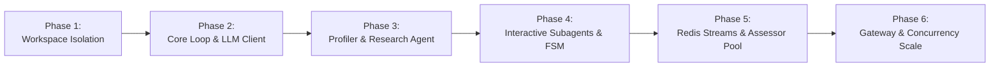

# AI Mock Interview Platform: Core Loop, Session Workspace & Subagent Engine
## Technical Design Specification

- **Date:** 2026-09-24
- **Status:** Draft v2 / Pending Approval
- **Deployment Model:** Single-node runtime; multiple local async worker processes are allowed, but horizontal multi-node execution is out of scope.
- **Target Scale:** 100 concurrent connected interview sessions on one node, with bounded concurrent LLM generations.
- **Target Location:** `C:\Users\Admin\NNH\Projects\VScode\dpl_pvan`

---

## 1. Executive Summary & Goals

### 1.1 Objective
Build a production-oriented, standalone **AI Agent Runtime Engine** for an AI Mock Interview platform. The engine is logically decoupled from the Web/Business Backend service, runs on one deployment node, and provides:
1. **Isolated Session Workspace**: A secure, isolated directory per interview session for input data, dynamic context, conversation turns, evaluation artifacts, and final reports. All writes are atomic and all paths are resolved through `SessionWorkspaceManager`.
2. **Loop-first Core Engine**: Streaming-first agent loop (`RuntimeAgent`) supporting low-latency response tokens, safe progress events, soft schema validation for tool calls, bounded retries, cancellation, and error self-correction.
3. **Profiler & Research Agent**: A pre-flight agent that ingests candidate background (CV upload OR structured form with target job details), performs external research (company intel, market requirements, tech stack), and dynamically constructs the interview persona, knowledge scope, and stage timeline.
4. **Stage-Delegated Interactive Subagents**: Domain-specialized interviewers (e.g., Tech Lead, HR Manager) that talk directly to the candidate turn-by-turn over WebSocket without per-turn orchestrator bottlenecks.
5. **Background Assessor Worker Pool (Redis-backed)**: An idempotent async evaluation pipeline running over Redis Streams on the same node. Assessors analyze candidate answers and edge VAD (Voice Activity Detection) metrics concurrently without blocking the interactive dialogue.

### 1.2 Non-Goals (Deferred to Later Milestones)
- Built-in heavy audio processing (Speech-to-Text runs via external API; VAD runs on client edge device; Text-to-Speech runs via external streaming API).
- Long-term cross-session vector memory (focused currently on intra-session context & workspace persistence).
- Full MCP client infrastructure (designed with clean extension interfaces for future MCP server wiring).
- Horizontal multi-node runtime, shared filesystem, automatic failover, and cross-region high availability.
- Automated employment decisions. Reports are coaching artifacts for mock-interview practice, not hiring decisions.

### 1.3 Success Criteria

- A session can be resumed after a browser refresh without duplicating a candidate turn or losing a completed interviewer response.
- A report becomes available only after every expected assessment has succeeded; permanently failed assessments move the session to an explicit failure state.
- Duplicate HTTP requests, WebSocket messages, and Redis deliveries do not create duplicate turns, evaluations, or reports.
- Sensitive candidate data is authenticated, access-controlled, encrypted in transit and on the host volume, and deleted according to the configured retention policy.
- The target load test supports 100 connected sessions on one node under the concurrency profile defined in Section 4.2.

---

## 2. System Architecture & Component Boundaries

### 2.1 Decoupled Module Architecture

The system is split into two logically independent services communicating via versioned REST (Control Plane) and WebSocket (Data Plane). The AI Runtime, Redis, workspace volume, and assessor processes run on the same deployment node. Local process scaling is supported; multi-node scaling is not.

```
┌──────────────────────────────────────────────────────────────────────────────────┐
│                             Web Client (Browser / App)                           │
│     - Runs local VAD (Silero/WebRTC in WASM) to measure speech/pause metrics     │
│     - Duplex WebSocket connection (Microphone audio / Text / Live Tokens)        │
└─────────────────────────┬────────────────────────────────────────────────────────┘
                          │ (HTTPS / WSS)
┌─────────────────────────▼────────────────────────────────────────────────────────┐
│                        Module 1: Backend Service (Business / App)                │
│     - User Accounts, Authentication & Billing                                    │
│     - Candidate CV upload / Form data intake                                     │
│     - Reverse Proxy / Gateway forwarding to AI Runtime Service                   │
└─────────────────────────┬────────────────────────────────────────────────────────┘
                          │ Internal REST (Session Lifecycle) & WebSocket (Stream)
┌─────────────────────────▼────────────────────────────────────────────────────────┐
│                     Module 2: AI Agent Runtime Service (Standalone)              │
│                                                                                  │
│   ┌───────────────────────────────┐     ┌────────────────────────────────────┐   │
│   │   REST & WebSocket Gateway    │     │   SessionWorkspaceManager          │   │
│   │   - ConnectionManager         │     │   - Folder isolation (SHA-256)     │   │
│   │   - Rate Limit Semaphore      │     │   - Path Traversal Protection      │   │
│   └───────────────┬───────────────┘     └─────────────────┬──────────────────┘   │
│                   │                                       │                      │
│   ┌───────────────▼───────────────┐                       │                      │
│   │   Profiler & Research Agent   │                       │                      │
│   │   - Company & Market Recon    │                       │                      │
│   │   - Customizes StagePlan & Spec ──────────────────────┼─────────────┐        │
│   └───────────────┬───────────────┘                       │             │        │
│                   │                                       │             │        │
│   ┌───────────────▼───────────────┐                       │             │        │
│   │   StageDirector (FSM)         │                       │             │        │
│   │   - Stage transition control  │                       │             │        │
│   └───────────────┬───────────────┘                       │             │        │
│                   │                                       │             │        │
│   ┌───────────────▼───────────────┐                       │             │        │
│   │   Interactive Subagent Runner │                       │             │        │
│   │   - Realtime Token Streaming  │                       │             │        │
│   │   - Context Assembler         │                       │             │        │
│   └───────────────┬───────────────┘                       │             │        │
│                   │ (turn completed)                      │             │        │
└───────────────────┼───────────────────────────────────────┼─────────────┼────────┘
                    │ XADD job                              │             │
┌───────────────────▼───────────────────────────────────────┼─────────────┼────────┐
│                         Local Infrastructure Layer        │             │        │
│   ┌───────────────────────────────────────────────────┐   │             │        │
│   │   Redis (All-in-One):                             │   │             │        │
│   │   - State Cache: `session:{id}:state`             │   │             │        │
│   │   - Task Queue: Redis Streams (assessment jobs)   │   │             │        │
│   │   - Replayable Events: Redis Stream               │   │             │        │
│   │     `session:{id}:events`                         │   │             │        │
│   └───────────────────────┬───────────────────────────┘   │             │        │
│                           │ Dequeue                       │             │        │
│   ┌───────────────────────▼───────────────────────────┐   │             │        │
│   │   Background Assessor Worker Pool                 │   │             │        │
│   │   - Content & Rubric Assessor                     │   │             │        │
│   │   - Delivery & VAD Assessor                       ├───┘             │        │
│   │   - Final Report Synthesizer                      │                 │        │
│   └───────────────────────────────────────────────────┘                 │        │
│                                                                         │        │
│   ┌─────────────────────────────────────────────────────────────────────▼────┐   │
│   │   Local encrypted volume: `/workspaces/{normalized_session_id}/`         │   │
│   │   `inputs/` | `context/` | `turns/` | `evaluations/` | `reports/`        │   │
│   └──────────────────────────────────────────────────────────────────────────┘   │
└──────────────────────────────────────────────────────────────────────────────────┘
```

### 2.2 Single-Node Deployment Contract

- One runtime node owns the FastAPI gateway, `StageDirector`, Redis, local worker processes, and the workspace volume.
- Worker processes must access workspaces only through `SessionWorkspaceManager`; raw `session_id` values are never concatenated into filesystem paths.
- Redis is the source of truth for live lifecycle state, idempotency records, counters, leases, and replayable events. The workspace is the source of truth for immutable inputs and durable artifacts.
- Artifact writes use `write temporary file -> fsync -> atomic replace`. Redis state is updated only after the artifact write succeeds.
- Restart recovery reconstructs in-flight work from Redis pending entries and durable workspace artifacts. Host loss and high availability are explicitly outside this milestone.

---

## 3. Sequential Phasing & Milestones

To keep implementation strictly modular, testable, and maintainable, development is divided into 6 sequential phases. Each phase builds upon the previous phase without monolithic interdependencies.



---

### Phase 1: Isolated Session Workspace (`core/workspace`)

#### Purpose
Provide a secure, isolated sandbox folder per interview session to store all inputs, generated context, conversation turns, evaluation artifacts, and reports.

#### Key Components
1. **`SessionWorkspace`**:
   - `root_base`: Configurable base path via `WORKSPACE_ROOT_BASE` (default `./data/workspaces`).
   - `normalized_session_id`: Replaces non-alphanumeric chars with `_` and appends `-{sha256(session_id)[:12]}`.
   - `resolve_path(rel_path)`: Resolves path and strictly asserts `resolved.is_relative_to(root.resolve())`. Raises `WorkspacePathError` if path traversal is detected (`../`).
   - `SessionWorkspaceManager` creates and persists the canonical mapping from `session_id` to `normalized_session_id`; all gateway and worker code resolves paths through this manager.
   - Writes JSON and report artifacts atomically through a shared `write_artifact()` helper. Artifacts include `schema_version`, `session_id`, `artifact_type`, `created_at`, and a SHA-256 content checksum.
2. **Directory Structure**:
   ```
   /workspaces/{normalized_session_id}/
   ├── inputs/
   │   └── input_source (cv_input.pdf / .txt OR form_input.json)
   ├── context/
   │   ├── company_intel.json
   │   ├── candidate_profile.json
   │   ├── interview_spec.json
   │   └── stage_plan.json
   ├── turns/
   │   ├── turn_001_candidate.json
   │   ├── turn_001_interviewer.json
   │   └── ...
   ├── evaluations/
   │   ├── turn_001_eval.json
   │   └── ...
   ├── reports/
   │   ├── final_assessment.json
   │   └── interview_report.md
   └── spill/
       └── spill_tool_*.json
   ```
3. **Workspace Spillover (`spill.py`)**:
   - When any tool output or context slice exceeds `MAX_TOOL_RESULT_BYTES` (32 KB), saves the full payload to `spill/` and returns `{ "spill_path": "...", "preview": "..." }` to protect LLM context windows.
   - Spill references are workspace-relative paths, never absolute host paths, and are subject to the same retention policy as the session.
4. **Input & Data Security (`security.py`)**:
   - Accepts PDF, UTF-8 text, or JSON only. Defaults: maximum upload size 10 MB, PDF page count 50, text length 500,000 characters, and JSON nesting depth 20.
   - Validates filename, declared MIME type, magic bytes, parseability, and decompressed size. Uploaded content is never executed; archive formats and embedded executable files are rejected.
   - Treats CV text, form fields, and web research as untrusted data. They are delimited from system instructions and cannot alter tool permissions, lifecycle policy, or evaluator rubric.
   - Runs on encrypted host volumes, including Redis persistence and workspace storage; all network traffic uses TLS. Logs and metrics must not contain CV text, answers, access tokens, raw prompts, or report contents.
5. **Retention & Deletion**:
   - Defaults are configurable: replay events expire after 24 hours; raw uploads are deleted 24 hours after report generation; remaining session artifacts expire after 30 days.
   - `DELETE /api/v1/sessions/{session_id}` cancels active work, deletes Redis keys and workspace artifacts, and records only a content-free deletion audit event.
   - Cleanup is idempotent and retries partial deletion after restart.

---

### Phase 2: Core Loop & LLM Client (`core/runtime`)

#### Purpose
Deliver a streaming-first loop engine adapted from `ai-agent-ai`'s `packages/agent-runtime`, optimized for high-throughput streaming and low TTFT. Production-readiness is established only by the verification gates in Section 5.

#### Key Components
1. **`RuntimeLLMClient` Protocol & Implementations**:
   - Generic async protocol:
     ```python
     async def stream_chat(
         self,
         messages: list[dict[str, Any]],
         tools: list[RuntimeTool] | None = None,
         temperature: float = 0.7,
     ) -> AsyncIterator[IterationChunk]: ...
     ```
   - Each provider adapter declares capabilities: `streaming`, `tool_calls`, `usage_events`, `cancellation`, and `safe_reasoning_summary`. Unsupported capabilities fail during session initialization rather than mid-turn.
   - `OpenAIRuntimeLLMClient` is the first implementation. Azure OpenAI, Groq, OpenRouter, and local vLLM require separate configuration profiles and provider contract tests before being marked supported.
2. **`LoopEvent` Types**:
   - `PROGRESS`: Safe coarse-grained status such as `preparing_question` or `checking_tool_result`; raw chain-of-thought is never emitted or persisted.
   - `REASONING_SUMMARY`: Optional provider-supported, user-safe summary. It is disabled by default and must not contain hidden prompts or tool credentials.
   - `RESPONSE_TOKEN`: Streamed assistant verbal tokens.
   - `TOOL_CALL_START` & `TOOL_CALL_RESULT`: Tool invocation lifecycle.
   - `COMPLETE`: Turn completed with final text and usage.
   - `ERROR`: Recoverable or fatal error details.
3. **`RuntimeAgent` (Execution Loop)**:
   - Budget control: Configurable `max_iterations` per turn (default 5).
   - Fast-path streaming: Skips deepcopies and heavy log serialization on high-frequency token events.
   - Soft schema validation: Collects tool call violations and feeds them back into the loop so the model self-corrects without crashing.
   - Tool Nudge: One-shot retry if model calls tools but returns empty verbal content.
   - Retry budget: at most one schema-repair retry and one transient-provider retry per iteration, bounded by `max_iterations` and a per-turn deadline.
   - Cancellation: client disconnect does not automatically cancel generation; explicit session cancellation propagates to the provider adapter when supported.
   - Every emitted event carries `schema_version`, `event_id`, `session_id`, `turn_id`, `sequence`, `timestamp`, `type`, and `visibility`. Only events with validated client-safe payload schemas may use `visibility=client`.

---

### Phase 3: Pre-flight Profiler & Research Agent (`core/profiler`)

#### Purpose
Ingest the candidate's initial input, perform reconnaissance on the target company and job role, and construct a bespoke interview blueprint.

#### Flow & Logic
1. **Input Ingestion**:
   - Reads either `inputs/cv_input.*` or `inputs/form_input.json`.
   - Extracts candidate experience, core technologies, notable projects, target company, target job title, and level.
2. **Research & Recon Tools**:
   - `web_search`: Queries company engineering culture, recent tech stack disclosures, interview experiences (e.g. Glassdoor/Reddit/tech blogs).
   - `market_intel`: Retrieves standard competency benchmarks for the role and level.
   - Outbound fetches enforce HTTPS, DNS/IP validation that blocks loopback/private/link-local targets, redirect limits, response-size limits, and request deadlines.
   - Every research fact stores source URL, retrieval time, and confidence. Community sources may shape practice questions but cannot be presented as verified company policy.
3. **Generated Artifacts (`context/`)**:
   - `company_intel.json`: Company tech stack, architectural challenges, hiring bar style (e.g., FAANG vs High-growth Startup).
   - `candidate_profile.json`: Candidate-provided strengths, evidence-backed observations, uncertain gaps, and resume claims to probe. Candidate claims are never labeled verified solely because they appear in the CV.
   - `interview_spec.json`:
     - `interviewer_persona`: Name, title, persona style.
     - `tone`: E.g., `"rigorous_challenger"`, `"collaborative_mentor"`, `"standard_corporate"`.
     - `knowledge_scope`: List of required tech topics (e.g. `["Distributed Caching", "DB Indexing", "Concurrency Locks"]`).
   - `stage_plan.json`:
     - Stage 1: Warmup & CV Walkthrough (Target: 2-3 turns).
     - Stage 2: Deep Technical & System Problem Solving (Target: 4-6 turns).
     - Stage 3: Behavioral & Conflict / STAR Scenarios (Target: 2-3 turns).
     - Stage 4: Candidate Q&A & Wrap-up (Target: 1-2 turns).

---

### Phase 4: Stage Director & Interactive Subagents (`core/interview`)

#### Purpose
Orchestrate stage transitions and run turn-by-turn conversational loops with minimal latency and high contextual coherence.

#### Key Components
1. **`StageDirector` (Finite State Machine)**:
   - Happy-path lifecycle: `INITIALIZED` -> `PROFILING` -> `READY` -> `STAGE_ACTIVE` <-> `STAGE_TRANSITIONING` -> `DIALOGUE_COMPLETED` -> `ASSESSING` -> `REPORT_READY`.
   - `ASSESSMENT_FAILED` is recoverable through an idempotent operator requeue back to `ASSESSING`. Exceptional terminal states are `FAILED`, `CANCELLED`, and `EXPIRED`. A structured `failure_code`, safe client message, and internal correlation ID are stored for failures.
   - Coordinates transition criteria (turn budget reached OR subagent explicitly calls `complete_stage`).
   - Lifecycle transitions use compare-and-set against a monotonically increasing `state_version`; stale or duplicate commands cannot move the session backward.
2. **`ContextAssembler`**:
   - Assembles an ultra-condensed prompt envelope per stage (< 1500 tokens) so the Subagent doesn't waste turns or latency reading files:
     - Active Persona and Target Tone.
     - Stage Goals and Key Questions to Cover.
      - Relevant Candidate Profile extracts.
      - Recent in-stage turn summary.
   - The 1500-token target is measured with the active model tokenizer. When over budget, content is removed by deterministic priority: old raw turns, low-confidence research, then non-critical profile detail. Stage goals, safety policy, and current question/answer are never truncated.
3. **`InteractiveSubagentRunner`**:
   - Receives candidate input message (with edge VAD metrics).
   - Runs `RuntimeAgent.run_loop_streaming()`.
   - Emits safe `PROGRESS`, optional `REASONING_SUMMARY`, and `RESPONSE_TOKEN` events through the session event stream.
   - Persists turns to `turns/turn_{n}_{role}.json`.
   - On turn finish: Enqueues assessment through an `AssessmentQueue` protocol. Phase 4 uses an in-memory test implementation; Phase 5 wires the Redis Streams implementation.
4. **Turn Ordering & Idempotency**:
   - The client sends a UUID `message_id`; the server assigns the canonical monotonic `turn_id` and returns both in every event.
   - Only one active candidate-processing task is allowed per session through a per-session async lock. A second simultaneous connection replaces the old connection lease; stale connections may read events but cannot submit answers.
   - Repeated `message_id` values return the recorded result and never invoke the LLM or assessor twice.
   - A candidate answer is accepted only while the session is `STAGE_ACTIVE`; out-of-order or stale-stage submissions return a typed conflict error.

---

### Phase 5: Background Assessor Worker Pool (`core/assessor`)

#### Purpose
Perform rubric scoring, STAR analysis, and descriptive VAD delivery observations in the background without slowing down live conversation.

#### Key Components
1. **Redis Task Stream (`interview:tasks:assessment`)**:
   - Message payload:
     ```json
      {
        "schema_version": "1.0",
        "job_id": "sess_12345:turn_002:rubric_v1",
        "session_id": "sess_12345",
        "turn_id": "turn_002",
       "stage_id": "stage_2_tech",
       "question": "How do you mitigate database cache stampede?",
       "candidate_text": "I implement distributed mutex locks using Redis...",
       "vad_metrics": {
         "speech_duration_ms": 14200,
         "pause_count": 2,
         "total_silence_ms": 1800,
         "words_per_minute": 130
       },
        "rubric_version": "rubric_v1",
        "rubric_target": ["Distributed Locking", "Concurrency", "Graceful Degradation"],
        "input_sha256": "..."
      }
     ```
2. **Worker Pool Execution (`AssessorWorker`)**:
   - Uses consumer group `assessor_workers` for multiple local worker processes on the same runtime node.
   - Delivery semantics are at-least-once. `job_id` plus `input_sha256` and `rubric_version` form the idempotency key; an existing matching artifact is returned without re-running the LLM.
   - Workers acknowledge with `XACK` only after the evaluation artifact is atomically persisted and Redis atomically records the `job_id` in the completed set. Counters are derived from set cardinality, preventing double increments after crashes or duplicate delivery.
   - A recovery task uses `XAUTOCLAIM` for jobs idle beyond the lease timeout. Transient failures use exponential backoff with jitter, maximum three attempts, then move to `interview:tasks:assessment:dead_letter`.
   - Evaluates:
      - **Content Score (1-10)**: Accuracy, depth, edge-case awareness, structured thinking.
      - **Communication Structure Score (1-10)**: Clarity, organization, relevance, and explicit reasoning visible in the answer text.
      - **Delivery Observations (non-scoring)**: Reports speech duration, pace, and pause patterns descriptively. VAD metrics must not be used to infer competence, personality, disability, truthfulness, or hiring suitability.
   - Writes the result through `SessionWorkspaceManager` to `evaluations/turn_{n}_eval.json` in the canonical normalized workspace.
   - Appends an `assessment_completed` event to the replayable Redis Stream `session:{session_id}:events`; the gateway broadcasts it to connected clients.
3. **Report Synthesizer Subagent**:
   - `DIALOGUE_COMPLETED` freezes `expected_assessment_count`. The session enters `ASSESSING`; the synthesizer starts only when `completed_assessment_count == expected_assessment_count` and `failed_assessment_count == 0`.
   - A permanently failed assessment moves the session to `ASSESSMENT_FAILED` with `failure_code=ASSESSMENT_EXHAUSTED`; no apparently complete report is published. An operator may requeue the failed job idempotently, returning the session to `ASSESSING`.
   - Aggregates all `turn_*_eval.json` files and `candidate_profile.json`.
   - Generates:
      - `reports/final_assessment.json`: Versioned numerical practice metrics (Technical, Problem Solving, Communication Structure) with per-score evidence references, rubric version, confidence, and limitations.
      - `reports/interview_report.md`: Mock-interview readiness summary, demonstrated strengths, specific improvement areas, and recommended study curriculum. It must state that the output is AI-generated coaching feedback and not an employment decision.
   - Writes the report atomically, appends `report_ready`, and only then transitions the lifecycle to `REPORT_READY`.

---

### Phase 6: Gateway, Protocol & Concurrency Scale (`api/gateway`)

#### Purpose
Expose authenticated, versioned REST and WebSocket endpoints and govern resources for the defined 100-session single-node load profile.

#### Key Components
1. **REST Endpoints (`api/v1/sessions`)**:
   - `POST /api/v1/sessions`: Upload CV or JSON form with an `Idempotency-Key`; returns `202 { session_id, status: "PROFILING" }`. Repeating the same key and payload returns the original session; reusing the key with a different payload returns `409`.
   - `GET /api/v1/sessions/{session_id}`: Returns lifecycle state, `state_version`, stage info, assessment counters, and safe failure details.
   - `GET /api/v1/sessions/{session_id}/report`: Returns `200` only in `REPORT_READY`, `202` while processing, `409` for assessment-failed/failed/cancelled sessions, and `404` when absent or unauthorized.
   - `POST /api/v1/sessions/{session_id}/cancel`: Idempotently cancels profiling, generation, queued assessments, and report synthesis.
   - `DELETE /api/v1/sessions/{session_id}`: Performs the retention deletion flow described in Phase 1.
2. **WebSocket Gateway (`/ws/sessions/{session_id}/stream`)**:
   - Connection lifecycle:
     - Validates session.
     - Registers with `ConnectionManager`.
     - Reads the replayable session event stream from the client's last acknowledged event ID, then tails new events.
     - Streams incoming candidate messages to `InteractiveSubagentRunner`.
    - Message Protocol Envelopes:
      - Common fields: `schema_version`, `event_id`, `session_id`, `turn_id`, `sequence`, `timestamp`, `type`, `payload`.
      - Inbound: `candidate_answer`, `start_stage`, `ack`, `ping`. Mutating messages include `message_id`, expected `state_version`, and connection lease ID.
      - Outbound: `progress`, optional `reasoning_summary`, `response_token`, `turn_complete`, `stage_transition`, `assessment_update`, `report_ready`, `session_failed`, `session_cancelled`, `error`.
     - Reconnect: client sends `last_event_id`; the gateway replays retained events in order. Token events are retained until 24 hours after turn completion. If the cursor has expired, the gateway emits `resync_required` with the latest durable turn snapshot.
     - Versioning: major schema mismatches are rejected with `unsupported_schema_version`; backward-compatible minor fields may be ignored. Persisted artifacts and events retain their original schema version for deterministic replay.
3. **Resource & Rate Limit Governor (Scale 100 Users)**:
   - Separate configurable semaphores govern interactive LLM generations, profiler/research calls, assessor calls, and report synthesis. Defaults are derived from measured provider RPM/TPM quotas rather than hard-coded as a correctness assumption.
   - Queue wait is included in user-visible latency. When the interactive queue exceeds `MAX_INTERACTIVE_QUEUE_MS`, the server emits `busy` with bounded `retry_after_ms` and does not silently accumulate work.
   - Per-user and per-session token buckets limit session creation, answer submission, reconnect attempts, and tool invocations.
   - Redis state has a measured target of `< 100 KB` per active session excluding the capped replay stream. Memory limits and stream trimming are enforced by configuration and verified under load.
4. **Authentication & Authorization**:
   - Backend-to-runtime REST calls use a short-lived signed service token with audience, issuer, expiry, and request correlation claims.
   - WebSocket connections use a short-lived session token scoped to one `session_id` and allowed actions. Tokens are passed through the authorization header or a secure subprotocol, never query-string logs.
   - The runtime verifies token signature, expiry, audience, session scope, and revoked-session state for every connection and mutating command.
5. **Operations & Observability**:
   - Structured logs contain correlation IDs, session hashes, event types, latency, retry count, and safe error codes; no candidate content or secrets.
   - Metrics cover active connections, queue wait, TTFT, turn duration, provider errors, assessment lag, pending/reclaimed/dead-letter jobs, report latency, stream size, and cleanup failures.
   - `/health/live` checks the process only. `/health/ready` checks Redis, workspace read/write probe, worker heartbeat, and required provider configuration.

---

## 4. Performance & SLO Contract

### 4.1 Definitions

- **Connected session:** An authenticated WebSocket connection that may be idle. It does not imply an active LLM generation.
- **Accepted turn:** A valid `candidate_answer` admitted by the rate governor. `busy`, unauthorized, duplicate, and conflict responses are measured separately.
- **TTFT:** Time from acceptance of `candidate_answer` to the first `response_token`. It includes semaphore/queue wait and runtime processing; browser upload time is excluded.
- **Report latency:** Time from `DIALOGUE_COMPLETED` to `REPORT_READY`, including pending assessment and synthesis time.

### 4.2 Reference Single-Node Load Profile

- 100 authenticated WebSocket connections, with at most 20 candidate answers arriving in the same one-second window.
- Eight turns per session over a 30-minute interview; four local assessor worker processes by default.
- Provider quotas must be provisioned for the configured semaphore limits. A test run is invalid if throttled by credentials below the declared reference quota.
- Staging targets under this profile: accepted-turn TTFT P95 `< 1.2s`, P99 `< 2.5s`; unexpected connection drop rate `< 0.1%`; `busy` response rate `< 1%`; no lost or duplicate completed turns; assessment lag returns to zero; report latency P95 `< 60s` after dialogue completion.
- A mock-provider benchmark measures runtime overhead and determinism but cannot prove provider latency. SLO approval requires a separate staging run against each enabled provider/model/region profile.

---

## 5. Verification & Testing Strategy

Production-readiness evidence covers the following tiers:

1. **Unit Testing (`pytest`)**:
   - `test_workspace.py`: Folder isolation, canonical ID mapping, path escape and symlink escape detection, atomic writes, checksum validation, spillover, and idempotent cleanup.
   - `test_runtime_agent.py`: Token streaming, safe progress events, tool execution, schema recovery, retry budgets, cancellation, deadline, and iteration termination.
   - `test_context_assembler.py`: Token-budget enforcement, deterministic truncation priority, and preservation of mandatory instructions.
   - `test_stage_director.py`: Legal/illegal lifecycle transitions, compare-and-set state versions, cancellation, expiry, and report barrier behavior.
2. **Integration Testing with Real Redis**:
   - `test_assessment_queue.py`: `XACK` after persistence, duplicate delivery, worker crash, `XAUTOCLAIM`, retry exhaustion, dead-letter flow, and idempotent requeue.
   - `test_event_replay.py`: Ordered replay, duplicate acknowledgements, expired cursor resync, stream trimming, and reconnect during an active generation.
   - `test_auth.py`: Expired, wrong-audience, wrong-session, revoked, malformed, and replayed credentials.
3. **End-to-End Simulation**:
   - `test_mock_interview_flow.py`: Complete four-stage interview from ingestion through `REPORT_READY`, including all expected assessment counters.
   - `test_recovery_flow.py`: Process restart during profiling, response streaming, assessment persistence, report synthesis, and deletion.
   - Assertions include no duplicate LLM calls for repeated `Idempotency-Key` or `message_id`, no report before the assessment barrier, and no candidate content in logs.
4. **Security & Data-Governance Testing**:
   - Fuzz path traversal, symlink escape, MIME mismatch, oversized/decompression-bomb input, malformed JSON, prompt injection, SSRF/private-IP redirects, and unauthorized cross-session access.
   - Verify retention expiry and explicit deletion remove workspace files, Redis keys, replay events, and cached idempotency results.
5. **Provider Contract Testing**:
   - Each enabled provider/model profile must pass streaming, tool-call, usage, cancellation, timeout, malformed-event, and rate-limit tests. Unsupported capability combinations fail at startup or session initialization.
6. **Load, Burst & Soak Testing**:
   - `tests/load/stress_test_100_sessions.py` runs the Section 4.2 profile and reports full latency histograms, busy rate, connection drops, duplicate/lost turns, Redis memory, assessment lag, dead letters, process memory, and event-loop lag.
   - Run a 30-minute burst test and a minimum two-hour soak test. Success requires every Section 4.2 target, zero lost/duplicate completed turns, zero unexpected dead letters, and zero unresolved assessment jobs.

---

## 6. Directory & File Organization (Deliverable Layout)

```
dpl_pvan/
├── core/
│   ├── workspace/
│   │   ├── __init__.py
│   │   ├── session.py            # Workspace, manager & canonical ID mapping
│   │   ├── spill.py              # Large content spillover handling
│   │   ├── security.py           # Path, upload & content validation
│   │   └── cleanup.py            # Retention and idempotent deletion
│   ├── runtime/
│   │   ├── __init__.py
│   │   ├── agent.py              # RuntimeAgent (Core Loop)
│   │   ├── types.py              # LoopEvent, LoopEventType, LoopStatus
│   │   ├── client.py             # RuntimeLLMClient protocol & capabilities
│   │   ├── providers/
│   │   │   └── openai.py         # First supported provider adapter
│   │   └── tooling.py            # RuntimeTool, validator, adapter
│   ├── session/
│   │   ├── state.py              # Versioned lifecycle & CAS transitions
│   │   ├── events.py             # Replayable events & cursor handling
│   │   └── idempotency.py        # HTTP, turn & job idempotency
│   ├── profiler/
│   │   ├── __init__.py
│   │   ├── agent.py              # ProfilerAgent (Company & CV recon)
│   │   ├── tools.py              # Web search & Market intel tools
│   │   └── prompts.py            # Profiler prompt templates
│   ├── interview/
│   │   ├── __init__.py
│   │   ├── director.py           # StageDirector (FSM & Transitions)
│   │   ├── runner.py             # InteractiveSubagentRunner
│   │   ├── context.py            # ContextAssembler
│   │   └── queue.py              # AssessmentQueue protocol & test adapter
│   └── assessor/
│       ├── __init__.py
│       ├── worker.py             # AssessorWorker (Redis Streams consumer)
│       ├── subagent.py           # Rubric evaluator & delivery observations
│       ├── queue.py              # Redis Streams producer & consumer helpers
│       └── synthesizer.py        # Final Report Synthesizer
├── api/
│   ├── __init__.py
│   ├── main.py                   # FastAPI application factory
│   ├── auth.py                   # Service/session token verification
│   ├── schemas.py                # Versioned protocol envelopes
│   ├── routes.py                 # Session lifecycle REST endpoints
│   └── websocket.py              # Leases, replay & ConnectionManager
├── config/
│   ├── __init__.py
│   └── settings.py               # Pydantic Settings (Redis, LLM keys, Workspace base)
├── tests/
│   ├── unit/
│   │   ├── test_workspace.py
│   │   ├── test_runtime_agent.py
│   │   ├── test_context_assembler.py
│   │   └── test_stage_director.py
│   ├── integration/
│   │   ├── test_assessment_queue.py
│   │   ├── test_event_replay.py
│   │   ├── test_auth.py
│   │   ├── test_mock_interview_flow.py
│   │   └── test_recovery_flow.py
│   ├── security/
│   │   └── test_untrusted_inputs.py
│   └── load/
│       └── stress_test_100_sessions.py
└── docs/
    └── superpowers/
        └── specs/
            └── 2026-09-24-ai-interview-core-engine-design.md
```
